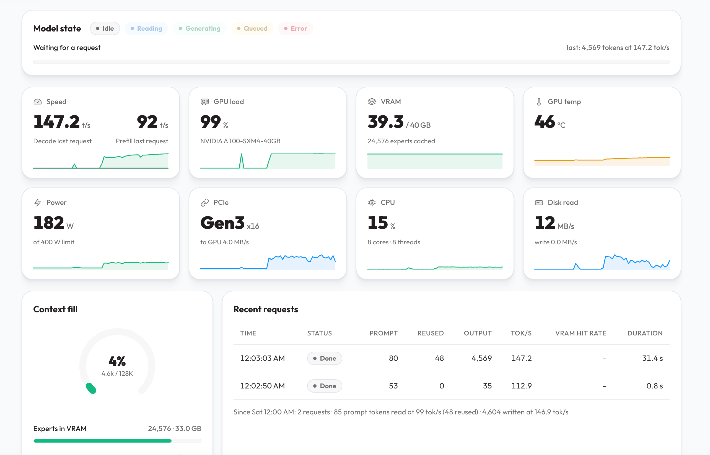
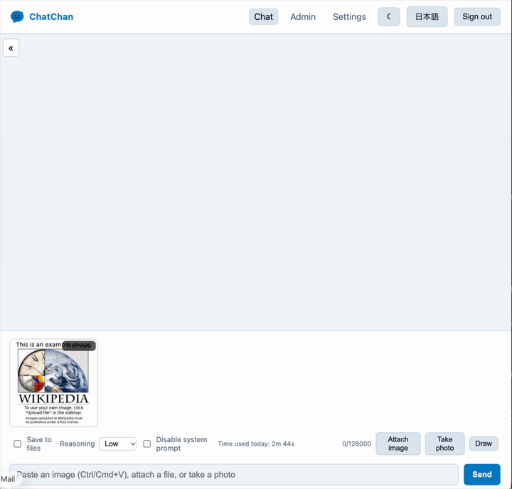

A100 + Strata を使うことで、125B モデルで 140-150 Token/s という爆速が出るようになりました。
<!--more-->

## Strata をつかってみた。

[Strata](https://github.com/Niko1221/Strata/blob/main/README.ja.md) が最近話題です。
125B パラメータのモンスター LLM である Qwen3.8-Flash-Next をコンシューマー向け GPU でも動かせてしまう代物です。

[前回の記事](../52)では、Qwen3.8-27B を A100 で頑張って動かしましたが、まさか Strata で動かせてしまう？
ということで試しました。

## 140 Token/s !?

いきなり結果にいきますが、Strata を使い A100 で動かし、前回の記事と同じくコード生成を試みたところ、以下の通り爆速です・・・・

スピードを見たところ、140 Token/s という、前回の Qwen3.8-27B で行った時の 3-4 倍近いパフォーマンスが出ていることになります。

ちなみに、Image-to-Text もできており、以下はサンプルイメージを OCR で文字起こししているところですが、このスピード・・・おそろしすぎる

以下雑多に感想を書いていきます。

- 精度も高くなり、スピードも速くなってどういうこと！？状態
- モデルを動かす手段として一時は vLLM が最強格と考えていたが、その概念が崩れてしまった
- A100 のメモリのバス転送速度の恩恵が非常に大きく、Strata が公表しているベンチマーク数値を超える
- vLLM 以上にインストールが簡単
- インストールの手順に従い KV Cache は今のところ 128k に設定、KV Cache を増やしたい場合は多分 GPU が複数枚必要
- Qwen3.8-27B の限界も感じてきてはいたので、新たな武器を得られた気分

追加で、特にメモリ周りの概念が大きく変わったのでそこも追記します。

## インフラ構成

以下のような仮想マシンをアサインしています。

- CPU 8 Core / Xeon E5-2697 v4
- メモリ 64GB
- Disk 150GB / NVMe
- A100 40GB をパススルーでアサイン

見ての通り、CPU の型番がかなり古いので、そこがボトルネックになるかと思っていましたが、そんなこともないようです。

## RAM vs vRAM

Qwen3.8-Flash-Next はモデルサイズだけでも 70GB 近くあります。
対して A100 の 40GB はその名の通り、vRAM サイズが 40GB しかないです。

前回の vLLM ベースの知識しかなかった私は、「モデルは vRAM にロードされるので、40GB のサイズを超えるモデルはホスティング不可」、さらには KV Cache 領域も
vRAM を使うため、Qwen3.8-27B 以外で妥当なモデルを A100 (40GB) 一枚で動かすのは不可能と思い込んでいました。
実際に Qwen3.8-27B でも何回か、KV Cache の設定を誤り、vRAM を溢れて RAM 領域まで使うようなケースがあったのですが、それが発生すると、
極端なパフォーマンス劣化を経験しました。それらの経験から「vRAM を溢れたら負け」という感覚をもってしまっていました。

対して Strata のアプローチは異なっており、vRAM だけでなく、RAM も効率的に使うようになっています。
Mixture of Experts (MoE) モデルの特性を活かし、本当に必要なものだけを vRAM に配置するようです。
結果として RAM にモデルの一部や KV Cache を逃がしている状況ですが、それをほぼ感じさせることなく、ものすごいスピードでやりきっている印象です。

100B を超えるモデルを 40GB 程度の vRAM 一枚で、このスピード・・・とんでもない時代に突入してしまった感覚です。

## まとめ

A100 が Strata によって新時代に突入してしまいました・・・
