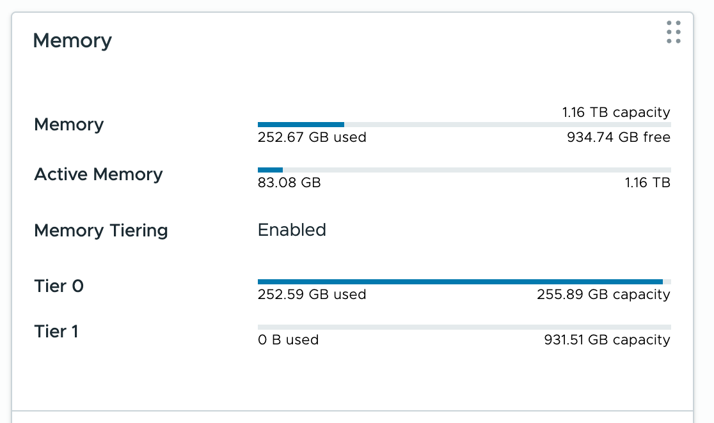
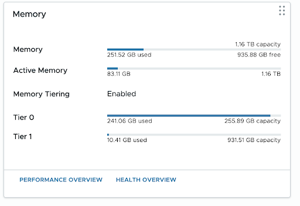

I enabled NVMe memory tiering on ESXi 9.1, but the VMs never actually got tiered. Chasing down the cause led me to the CPU generation and the monitor mode (CPL0 / ULM).
<!--more-->
## Symptoms

I configured NVMe memory tiering on my home lab ESXi 9.1.1 host running a Xeon E5-2697 v4 (Broadwell).
From the host's point of view, it is properly set up with two tiers: DRAM + NVMe.
However, no matter how much Tier 0 overflowed, Tier 1 was never used.



Then, when I looked at a VM's `vmware.log` from ESXi, the following was recorded.

```
MemSched: enableTiering: 0
```

`memstats -r vmtier-stats` also showed `isTiered = n` for every VM. And vmkernel.log said this:

```
VmMemNvme: vm NNN: 473: Sw tiering disabled in VM: IsSwTieringEnabled (0) and NVMe present (1), Cancelling setup
```

From this, it seems that even though Memory Tiering is enabled on the host, it is not enabled for the virtual machines.


## Cause

Every VM's log also showed `Monitor Mode: CPL0`.
This appears to be the cause. It seems that the Monitor Mode needs to be ULM for Memory Tiering to be enabled.
I never figured out exactly why it ends up in CPL0, but it seems to be because I'm using an old CPU, Broadwell.

## How to Fix It

***The following is not an official procedure, so do it at your own risk.***

Run the following on ESXi.

```
echo 'monitor.ulm = "TRUE"' >> /etc/vmware/config
/sbin/auto-backup.sh
```

After that, fully power off each VM (a restart is not enough) and power it back on for the setting to take effect.

After doing this, Tier 1 memory was finally used.



Honestly, I don't know what the downsides of this setting are, so once again, please do this at your own risk.

## Summary

It seems you need to be careful when setting up Memory Tiering on old hardware.
